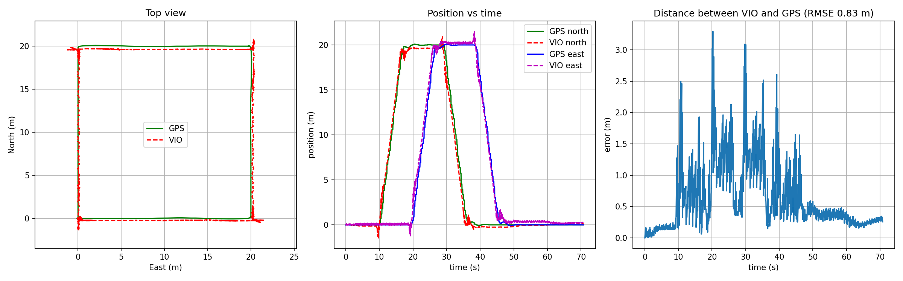

# Visual inertial odometry on an ArduPilot SITL drone in Gazebo

A simulated Iris quadcopter flies a 20 m square at 10 m height in Gazebo Harmonic. A downward camera under the drone feeds a small visual odometry program written in Python. The VIO position is then compared with the drone's GPS position. 

Result from one run: the VIO track stays within 0.59 m RMSE of GPS over about 80 m of flight.



Left to right: top view of both paths, north and east against time, and the distance between VIO and GPS over time.

## Videos

| Task | Link |
|---|---|
| 1. Takeoff and landing |https://drive.google.com/file/d/13pYd_9B3QAZiIeQfyG02QTDcNRfVFqeX/view|
| 2. Camera VIO while flying the square |https://drive.google.com/file/d/17YG8Qb2CK7NwdHkgiRnGHTyuaUI4xIiN/view?usp=sharing|

## What is in the repo

| File | Purpose |
|---|---|
| `setup.sh` | Installs Gazebo Harmonic, ArduPilot SITL and the ardupilot_gazebo plugin (task 1) |
| `make_world.py` | Generates a textured ground image and writes `world/vio_world.sdf` |
| `world_template.sdf` | World with the Iris, ground plane and a 640x480 downward camera |
| `fly_mission.py` | Takeoff and landing over MAVLink (task 2). `--square 20` also flies a square |
| `vio.py` | The visual inertial odometry itself (about 25 lines of core code) |
| `vio_sitl.py` | Reads the camera from Gazebo and attitude, height and GPS from ArduPilot, runs VIO, writes `log.csv` (task 3) |
| `plot_compare.py` | Draws the comparison plot and prints RMSE (task 4) |
| `vio_vs_gps.png` | Plot from my own run |

## Requirements

- Ubuntu 22.04
- Gazebo Harmonic (gz-sim 8)
- ArduPilot (ArduCopter SITL) and the ardupilot_gazebo plugin
- Python 3 with numpy, opencv, matplotlib and pymavlink

`setup.sh` installs all of this. It takes a while, mostly compiling.

## Install (task 1)

Run once:

```bash
bash setup.sh
```

Then open a new terminal so the environment variables are loaded, and check them:

```bash
echo $GZ_VERSION                  # harmonic
echo $GZ_SIM_RESOURCE_PATH        # should contain ardupilot_gazebo/models
which sim_vehicle.py              # should print a path
gz sim --version                  # 8.x
```

Then generate the world, also once:

```bash
python3 make_world.py
```

## Commands to run

Every task needs the same two terminals running first. Start them in this order, and give SITL a minute or two to get a GPS lock before sending flight commands.

### Terminal 1: Gazebo

```bash
cd ~/Downloads/vio_sitl
gz sim -v4 -r world/vio_world.sdf
```

### Terminal 2: ArduPilot SITL

```bash
cd ~/ardupilot
sim_vehicle.py -v ArduCopter -f gazebo-iris --model JSON --console --out 127.0.0.1:14551
```

The `--out` option adds a second MAVLink stream on port 14551 so the VIO program and the flight script do not fight over the same port.

For the VIO flight (task 3) start SITL with the extra parameter file instead. It tells ArduPilot to take its position from VIO and not from GPS:

```bash
cd ~/ardupilot
sim_vehicle.py -v ArduCopter -f gazebo-iris --model JSON --console --out 127.0.0.1:14551 --add-param-file=$HOME/Downloads/vio_sitl/vio.parm
```

Use the plain command for task 2.

### Task 2: takeoff and landing

Terminal 3:

```bash
cd ~/Downloads/vio_sitl
python3 fly_mission.py
```

The drone arms, climbs to 10 m, hovers for 5 seconds and lands. Use `--alt 15` for another height.

### Task 3: flying the square on VIO

Start SITL with `vio.parm` (see above). The drone now navigates on the VIO position. GPS is only logged for the comparison.

Terminal 3, start the VIO program first and wait for the `iris camera` window to open. Then wait about 40 seconds so the EKF settles on the VIO position before sending the flight script:

```bash
cd ~/Downloads/vio_sitl
python3 vio_sitl.py
```

Terminal 4, once the camera window is up:

```bash
cd ~/Downloads/vio_sitl
python3 fly_mission.py --square 20
```

In the camera window, green dots are the tracked corners and the yellow text shows VIO and GPS north/east in metres. When the drone has landed, click the camera window and press `q`. That writes `log.csv`.

### Task 4: GPS vs VIO comparison

```bash
cd ~/Downloads/vio_sitl
python3 plot_compare.py
```

It prints the RMSE, the largest error and the final error, and saves `vio_vs_gps.png`.

## How the VIO works

The camera looks straight down. Height comes from ArduPilot and roll, pitch and yaw come from ArduPilot's attitude estimate (the IMU part). For each new frame:

1. Find up to 200 Shi-Tomasi corners in the previous frame and track them into the new frame with pyramidal Lucas-Kanade optical flow. Drop points that were lost, and skip the frame if fewer than 10 survive.
2. For each corner, turn the pixel into a ray with the camera focal length, rotate the ray by the drone's attitude, and find where it hits the flat ground. Do this for the old pixel (old attitude and height) and the new pixel (new attitude and height).
3. The ground spot did not move, so the drone did. Its move is the median of (old ground offset minus new ground offset) over all corners. Add it to the position.

Tilting the drone moves the picture almost exactly like flying does. Using the attitude in step 2 removes that effect. Without it, a 5 degree tilt at 10 m would look like a 0.9 m move.

The focal length comes from the camera field of view, f = (width / 2) / tan(hfov / 2), which is 554.4 pixels for 640 px and 60 degrees. GPS is used only as the starting point and as the reference in the comparison. It is never used to correct the VIO.

## Results

| Metric | Value |
|---|---|
| RMSE, VIO vs GPS | 0.59 m ||

## Limits

- The ground is assumed flat and the height is trusted. On real terrain the scale would be wrong.
- Attitude and image are paired by "latest available", without timestamp matching.
- It is odometry only. There is no loop closure or any correction, so errors that do add up stay.
- It needs texture and light. A blank floor would give no corners. The generated ground has random shapes for that reason, and shadows are switched off because a moving shadow would fake motion.
